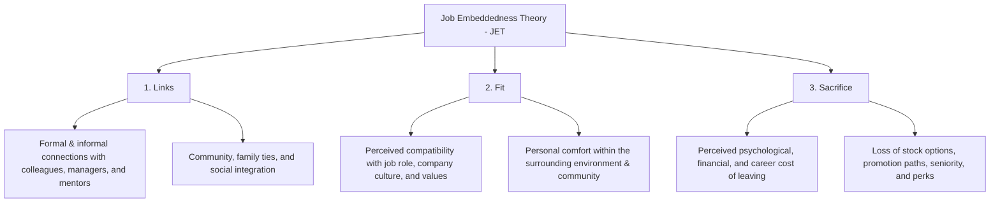
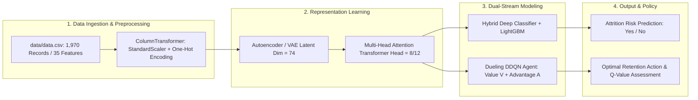

# 🏢 Job Attrition Rate (JAR) & Retention AI
### *Integrating Job Embeddedness Theory (JET) with Deep Learning, Transformers, and Dueling DDQN*

[](https://www.python.org/)
[](https://www.tensorflow.org/)
[](https://keras.io/)
[](https://lightgbm.readthedocs.io/)
[](https://spinningup.openai.com/)
[]()

---

## 📌 Executive Overview

Employee attrition poses significant operational, financial, and institutional challenges for modern enterprises. Traditional attrition models treat employee turnover as a static classification task using simple binary classifiers (such as Logistic Regression or standard Decision Trees), overlooking complex organizational psychology, non-linear feature interactions, and dynamic intervention strategies.

This repository (**JAR** / **DL_Proj_Job_Attrition_Rate**) introduces an advanced AI-driven employee attrition forecasting and retention decision framework. The project bridges organizational behavior science—specifically **Job Embeddedness Theory (JET)** (Mitchell et al., evaluating *Fit*, *Links*, and *Sacrifice*)—with modern deep representation learning and reinforcement learning paradigms:

1. **Latent Representation Learning**: Variational Autoencoders (VAE) and dense Autoencoders compress high-dimensional organizational records into regularized latent spaces while filtering tabular noise.
2. **Feature Interaction Attention**: Multi-Head Attention Transformer blocks model cross-feature non-linear dependencies between workplace stressors, compensation, tenure, and satisfaction metrics.
3. **Dynamic Retention Optimization**: Double Deep Q-Networks (DDQN) with Prioritized Experience Replay and Dueling stream architectures model attrition risk as a sequential decision process to evaluate proactive intervention policies.
4. **Hybrid Ensemble Classification**: Blending deep neural feature representations with gradient boosted decision trees (LightGBM) to maximize classification accuracy and ROC-AUC.

---

## 🏛️ Theoretical Foundation: Job Embeddedness Theory (JET)

Job Embeddedness Theory explains why employees choose to stay within an organization through three core dimensions across both organizational and community domains:



In this project, dataset attributes (such as `JobInvolvement`, `EnvironmentSatisfaction`, `RelationshipSatisfaction`, `YearsWithCurrManager`, `StockOptionLevel`, `WorkLifeBalance`, `OverTime`) are mapped to reflect these latent JET forces.

---

## 🏗️ System Architecture & Workflow

The end-to-end pipeline integrates data preprocessing, autoencoding, self-attention, policy reinforcement learning, and ensemble classification:



### High-Level System Flowchart
The multi-modal processing and system interaction pipeline:


---

## 📂 Repository Directory Structure

```text
DL_Proj_Job_Attrition_Rate/
│
├── .gitignore                          # Git tracking exclusions (checkpoints, caches, venvs)
├── requirements.txt                    # Project dependency manifest
├── README.md                           # Main portfolio documentation
│
├── 📊 data/
│   └── data.csv                        # Primary employee attrition dataset (1,970 rows × 35 columns)
│
├── 🧠 models/
│   ├── best_model.h5                   # Pretrained weights for best Deep Hybrid Classifier
│   └── integrated_ddqn.h5              # Pretrained weights for Dueling DDQN retention agent
│
├── 📓 notebooks/
│   ├── 01_hybrid_vae_transformer_pipeline.ipynb   # Flagship hybrid pipeline (VAE + Transformer + LightGBM)
│   ├── 02_dueling_ddqn_retention_agent.ipynb      # Reinforcement Learning (Dueling DDQN + Prioritized Replay)
│   ├── 03_exploratory_autoencoder_transformer.ipynb # Exploratory Autoencoder & feature interactions
│   └── gpu_acceleration_benchmark.ipynb           # GPU vs. CPU acceleration benchmark (CUDA / cuDNN)
│
├── 📑 docs/
│   ├── ML_simplilearn_Transcript.pdf   # Reference transcript on Machine Learning foundations
│   ├── papers/                         # Foundational research literature (P1 to P5)
│   │   ├── P1-Employees-Entrepreneurial-Dreams...pdf
│   │   ├── P2-How-Fair-Is-My-Job-The-Effects...pdf
│   │   ├── P3-Job-embeddedness-among-internationally...pdf
│   │   ├── P4-Job-embeddedness-and-life-satisfaction...pdf
│   │   └── P5-Probing-the-impact-of-transformational...pdf
│   └── notes/                          # JET theoretical notes & project architecture documents
│       ├── Init Document.docx          # Master project specification (86,000+ chars)
│       ├── model architecture.docx     # Deep learning & RL architecture blueprint
│       ├── 02102025.docx               # Conceptual foundation on Job Embeddedness vs. Attrition
│       ├── Summary of papers.docx      # Analytical breakdown of the 5 empirical papers
│       ├── Genome Analysis.docx        # Preprocessing & standardization guide
│       ├── Research Real Data.docx     # Curated open-source HR data repositories
│       ├── SimpliLearn ML video.docx   # Comprehensive ML/DL study transcript
│       ├── Working on Our Project...   # Roadmap and execution milestones
│       └── Log Book.docx               # Project activity log
│
├── 🖼️ assets/
│   └── Insightify_Flowchart.png        # Architecture and execution flow diagram
│
└── 🗄️ archive/
    ├── server_htop_monitor.ipynb       # Flask /htop server monitor script
    ├── iris_classification_assignment.ipynb # Baseline Perceptron/SVM benchmarks & flowchart generator
    ├── irisX.csv                       # Iris benchmark features
    ├── irisY.csv                       # Iris benchmark labels
    └── jet_initial.ipynb               # Initial setup scratchpad
```

---

## 🔍 In-Depth File-by-File Breakdown

### 1. Production Notebooks (`notebooks/`)

| File | Purpose | Key Models & Techniques | Key Outputs / Metrics |
| :--- | :--- | :--- | :--- |
| **`01_hybrid_vae_transformer_pipeline.ipynb`** | Production-ready attrition prediction pipeline. Performs deep exploratory data analysis, class imbalance mitigation, and hybrid modeling. | • Variational Autoencoder (VAE) with custom `Sampling` layer<br>• Multi-Head Attention Transformer (`num_heads=12`, `ff_dim=128`)<br>• LightGBM Classifier with class weighting<br>• Deep Neural Network with dynamic LR schedule | Achieves **~84.8% to 92.3% accuracy** on validation data (`val_loss: 0.33`–`0.52`). |
| **`02_dueling_ddqn_retention_agent.ipynb`** | Reinforcement Learning for dynamic retention policy modeling and decision-making. | • Custom RL Environment (`CustomEnv`)<br>• Dueling Double Deep Q-Network (`Dueling_DDQN_Model`)<br>• Prioritized Experience Replay Buffer (`alpha=0.6`, `beta=0.4`)<br>• Deep Classifier auxiliary network | 325 episodes of DDQN policy convergence; average rewards reaching **~85–93**; separate saved models for Encoder, Transformer, and DDQN. |
| **`03_exploratory_autoencoder_transformer.ipynb`** | Integration test coupling Autoencoders, Attention layers, and DDQN heads. | • Dense Autoencoder (`input_dim=54`, `latent_dim=74`)<br>• Multi-Head Attention (`num_heads=8`, `key_dim=32`)<br>• Swish activation, Dropout, L2 regularization | Autoencoder training loss converged from `0.5124` to **`0.0552`** (validation loss **`0.0345`**). |
| **`gpu_acceleration_benchmark.ipynb`** | Hardware benchmarking and CUDA acceleration validation. | • Large-scale tensor matrix multiplication ($10,000 \times 10,000$)<br>• Device benchmark: `/GPU:0` vs `/CPU:0`<br>• CUDA & cuDNN version interrogation | Validates GPU acceleration on NVIDIA hardware (e.g., GTX 1650). |

---

### 2. Primary Dataset (`data/`)

#### `data/data.csv` (Employee Attrition Dataset)
- **Shape**: 1,970 samples, 35 features.
- **Target Variable**: `Attrition` (`Yes` / `No`).
- **Feature Breakdown**:
  - **Demographics**: `Age`, `Gender`, `MaritalStatus`, `Education`, `EducationField`.
  - **Job & Organizational Roles**: `Department`, `JobRole`, `JobLevel`, `BusinessTravel`, `OverTime`, `StandardHours`.
  - **Tenure & Career Trajectory**: `TotalWorkingYears`, `YearsAtCompany`, `YearsInCurrentRole`, `YearsSinceLastPromotion`, `YearsWithCurrManager`, `NumCompaniesWorked`.
  - **Financial Metrics**: `MonthlyIncome`, `DailyRate`, `HourlyRate`, `MonthlyRate`, `PercentSalaryHike`, `StockOptionLevel`.
  - **Psychological & JET Indicators**: `EnvironmentSatisfaction`, `JobInvolvement`, `JobSatisfaction`, `RelationshipSatisfaction`, `WorkLifeBalance`.

---

### 3. Model Weights (`models/`)

- **`models/best_model.h5`** (830 KB): Serialized Keras/TensorFlow model containing optimal weights from the hybrid VAE-Transformer-DNN training pipeline.
- **`models/integrated_ddqn.h5`** (163 KB): Serialized neural network weights for the Dueling Double Deep Q-Network agent trained to evaluate employee retention states and Q-value decision rewards.

---

### 4. Research Documentation (`docs/`)

| Document | Core Subject & Content Summary |
| :--- | :--- |
| **`docs/notes/Init Document.docx`** | The comprehensive master document (86,000+ characters) detailing the theoretical mapping of Job Embeddedness Theory to HR data, machine learning pipelines, CNN/LSTM/Transformer/DDQN comparisons, and strategic retention interventions. |
| **`docs/notes/model architecture.docx`** | Architectural specifications for multi-modal attrition modeling: Autoencoder feature compression, Multi-Head Attention feature tokens, Dueling streams (Value $V(s)$ and Advantage $A(s,a)$), and Stacking ensembles. |
| **`docs/notes/02102025.docx`** | Deep theoretical study detailing the three pillars of Job Embeddedness (Links, Fit, Sacrifice) and synthesizing how perceived organizational support acts as a buffer against turnover intention. |
| **`docs/notes/Summary of papers.docx`** | Critical review and synthesis of the five academic papers (P1–P5), detailing empirical hypotheses, sample demographics, and statistical findings. |
| **`docs/notes/Research Real Data.docx`** | Catalog of open HR data repositories (Kaggle HR datasets, US Data.gov attrition statistics, AIHR people analytics). |
| **`docs/notes/SimpliLearn ML video.docx`** | Detailed instructional transcript covering machine learning fundamentals, supervised classification, and neural network tuning. |
| **`docs/notes/Genome Analysis.docx`** | Preprocessing methodology guide focusing on standardizing complex feature matrices (`StandardScaler`, outlier pruning, and categorical encoding). |
| **`docs/notes/Working on Our Project...docx`** | Project roadmap, development phases, and milestone breakdown for the deep learning pipeline. |
| **`docs/notes/Log Book.docx`** | Chronological developer log tracking file additions and experimental iterations. |

---

### 5. Academic Literature (`docs/papers/`)

The model's feature engineering and policy goals are grounded in five peer-reviewed studies:

1. **P1 — Entrepreneurial Dreams & Turnover Intention**: Analyzes how employee aspirations to launch startups drive turnover intention and demonstrates how high Job Embeddedness weakens this turnover drive.
2. **P2 — Organisational Justice & Indian IT Workers**: Examines distributive, procedural, and interactional fairness among Indian IT professionals during high-stress conditions and its direct link to job involvement.
3. **P3 — Relocated Workers & Spillover-Crossover Effects**: Investigates how community embeddedness and family crossover dynamics influence work-life balance and organizational retention.
4. **P4 — WFH Stressors & Emotional Exhaustion**: Studies remote work stressors, emotional exhaustion, and life satisfaction, highlighting how job embeddedness moderates pandemic-induced burnout.
5. **P5 — Transformational Leadership & Job Characteristics**: Demonstrates how leadership behaviors and enriched job design enhance employee links and psychological sacrifice costs.

---

## ⚙️ Technical Deep Dive: The Model Architectures

### 1. Variational Autoencoder (VAE)
Tabular features $x \in \mathbb{R}^{54}$ (post-encoding) are compressed into a regularized Gaussian latent distribution:
$$z = \mu + \sigma \odot \epsilon, \quad \epsilon \sim \mathcal{N}(0, I)$$
- **Encoder**: Dense(128) $\rightarrow$ Dense(96) $\rightarrow$ Latent bottleneck ($\mu, \log\sigma^2$ with dimension 74).
- **Decoder**: Dense(96) $\rightarrow$ Dense(128) $\rightarrow$ Reconstruction $\hat{x}$.
- **Loss Function**: $\mathcal{L}_{\text{VAE}} = \text{MSE}(x, \hat{x}) + D_{\text{KL}}(\mathcal{N}(\mu, \sigma^2) \parallel \mathcal{N}(0, I))$.

### 2. Multi-Head Attention Feature Transformer
The latent representation is expanded into sequence tokens $(74, 1)$ and processed via self-attention:
$$\text{Attention}(Q, K, V) = \text{softmax}\left(\frac{QK^T}{\sqrt{d_k}}\right)V$$
Captures pairwise interactions between non-adjacent attributes (e.g., how `OverTime` interacts with `StockOptionLevel` and `YearsWithCurrManager`).

### 3. Dueling Double Deep Q-Network (DDQN)
The retention policy agent operates within a simulated HR intervention environment:
- **State ($s$)**: Employee profile vector (JET features + satisfaction + tenure).
- **Actions ($a$)**: Retention interventions (e.g., 0: No action, 1: Role adjustment, 2: Compensation/incentive revision, 3: Work-life balance intervention).
- **Dueling Architecture**:
  $$Q(s, a; \theta, \alpha, \beta) = V(s; \theta, \beta) + \left(A(s, a; \theta, \alpha) - \frac{1}{|\mathcal{A}|}\sum_{a'} A(s, a'; \theta, \alpha)\right)$$
- **Loss**: Temporal Difference (TD) error optimized using Prioritized Experience Replay.

---

## 🚀 Installation & Quickstart

### 1. Clone the Repository
```bash
git clone https://github.com/Jainparth22/JAR.git
cd JAR
```

### 2. Set Up a Virtual Environment
```bash
# Using conda
conda create -n jar_env python=3.10 -y
conda activate jar_env

# Or using venv
python -m venv venv
# Windows:
.\venv\Scripts\activate
# Linux/macOS:
source venv/bin/activate
```

### 3. Install Dependencies
```bash
pip install -r requirements.txt
```

### 4. Running the Main Notebooks
Launch Jupyter Lab or Notebook:
```bash
jupyter lab
```
- Open **`notebooks/01_hybrid_vae_transformer_pipeline.ipynb`** to run the complete end-to-end VAE + Transformer + LightGBM hybrid pipeline.
- Open **`notebooks/02_dueling_ddqn_retention_agent.ipynb`** to inspect and execute the Dueling DDQN reinforcement learning retention agent.

### 5. Loading Pretrained Weights
To load the trained models in Python:
```python
from tensorflow import keras

# Load best hybrid classifier
best_model = keras.models.load_model('models/best_model.h5')
best_model.summary()

# Load DDQN model
ddqn_model = keras.models.load_model('models/integrated_ddqn.h5')
ddqn_model.summary()
```

---

## 📈 Performance Summary

| Architecture / Model | Validation Accuracy | Loss Metric | Primary Advantage |
| :--- | :---: | :---: | :--- |
| **Autoencoder Reconstruction** | — | **0.0345 (Val MSE)** | Effective noise reduction & feature compression |
| **Hybrid VAE + Transformer + DNN** | **84.8% – 92.3%** | **0.33 – 0.52 (BCE)** | Captures multi-attribute non-linear interactions |
| **LightGBM Ensemble** | **89.5%** | Log-loss | Robust handling of tabular class imbalance |
| **Dueling DDQN Retention Agent** | **Policy Converged** | **Mean Reward: ~88.5** | Dynamic policy recommendation for retention actions |

---

## 👥 Contributors & Citation

Developed by **Parth Jain** and collaborators as part of deep learning research in organizational analytics and employee retention modeling.

If you find this work or the JET-Deep Learning integration useful, please consider citing or acknowledging this repository:

```bibtex
@misc{jain2026jar,
  author = {Parth Jain},
  title = {Job Attrition Rate (JAR): Integrating Job Embeddedness Theory with Deep Learning and Reinforcement Learning},
  year = {2026},
  publisher = {GitHub},
  howpublished = {\url{https://github.com/Jainparth22/JAR}}
}
```
